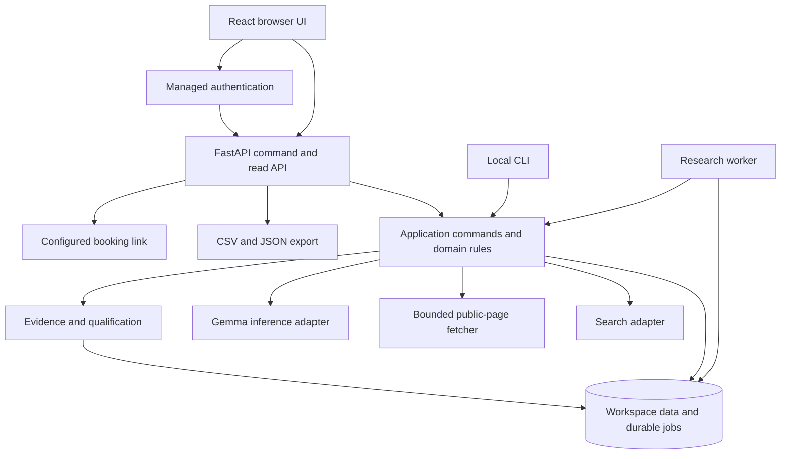

# GTM Shortlist: architecture and contracts

14 October 2026. Proposed design for a greenfield application. Interfaces and paths below are sketches, not implemented code. The existing Week 1 projects remain separate.

The product is GTM Shortlist, with an open-source core and an Eygentic managed service, explicitly confirmed by the user. Use [PRODUCT.md](PRODUCT.md) for product context and [DESIGN.md](DESIGN.md) for the inherited Eygentic identity. The workspace-root context files belong to a different app.

## Start with the caller

The hosted caller should need five operations, independent of search providers, queues, or model-serving details:

```text
demo = start_demo(authenticated_owner, seller_website, request_key)
draft = read_demo(demo.id)
confirm_target(demo.id, edited_offer, chosen_criteria, exclusions, request_key)
sample = read_demo(demo.id)                 # saved state and eventual records
review_company(demo.id, company_id, decision, reason)
export_accepted(demo.id, format="csv")
```

The core user with their own providers uses the same domain operations without a hosted trial entitlement:

```text
draft = research_seller(website, local_budget)
profile = confirm_profile(draft, edits)
run = start_research(profile.snapshot, local_budget, request_key)
resume(run.id)
review_and_export(run.id)
```

Browser and CLI do not coordinate individual provider calls. They receive a run identifier and read saved status. Account entitlement is a hosted policy; bounded resource use is a core capability.

## Compare execution designs

| Shape | Where work and state live | Useful properties | Problems for this product |
| --- | --- | --- | --- |
| A. Synchronous HTTP request with in-memory tasks | API process; browser waits for completion | Smallest initial prototype | Restart loses progress, retries can duplicate spending, browser lifetime affects the experience. |
| B. Modular application with database-backed jobs | Shared core; API issues commands; a worker leases persisted stages | Saved progress, resumable work, one budget owner, modest infrastructure | Requires leases, migrations, and careful transactions. |
| C. Workflow platform and multiple research services | Durable workflow engine coordinates services | Useful for complex long-running integrations and larger operations | More deployment concepts and integrations than this first workflow needs. |

Choose **B**. One repository and one domain core, with separate API and worker processes. It serves the saved-sample experience without requiring a workflow platform. Do not turn every module into a service. Reconsider C only when real workflows need waiting callbacks, many integrations, or operational scale that the simple queue cannot meet.

## Runtime shape



The diagram shows dependencies, not an agent allowed to invoke arbitrary tools. The worker executes a fixed sequence with typed inputs. Model output cannot change budgets, authorize network targets, book calls, or send messages.

## Proposed technology decisions

| Concern | Initial choice | Reason and limit |
| --- | --- | --- |
| Backend/core | Python with FastAPI and Pydantic boundary schemas | Fits model integration and explicit request/output parsing; the domain has no HTTP dependency. |
| Frontend | React + Vite + TypeScript | Small client for forms, polling, evidence, and review. Generate client contracts from the API schema. |
| Persistence | SQLAlchemy and migrations; SQLite locally, Postgres hosted | One data model with durable hosted state. Exercise both backends; do not assume identical concurrency. |
| Network/text | HTTPX for controlled requests; Trafilatura for HTML text extraction | Keep fetching and text extraction separate. Parser convenience does not replace network safety controls. |
| Hosted identity and database | Supabase Auth + Postgres, initially | Avoid operating authentication and a separate database service. Core research remains independent of Supabase. |
| Deployment | Render web process serving API and built UI; separate worker | Meaningful hosted use with persistent external database. Inference is not loaded into the web process. |
| Model | Evaluate Gemma 4 E4B and E2B; pin the checkpoint that passes | Actual hardware, schema quality, and latency choose the model. No performance guarantee yet. |
| Search | SerpApi and Tavily adapters; benchmark before setting hosted default | Same candidate/evidence contract with explicit per-provider credit units. |
| Monitoring | Structured counters first; Sentry if integrated before freeze | Record failures and latency without sending page contents, secrets, or customer research to telemetry. |
| Booking/payment | Existing booking link and manually confirmed pilot orders | The first sale does not require a billing subsystem. Verified billing webhooks come with subscriptions. |

Official references reviewed: [FastAPI](https://fastapi.tiangolo.com/), [SQLAlchemy](https://docs.sqlalchemy.org/en/20/intro.html), [HTTPX](https://www.python-httpx.org/), [Trafilatura](https://trafilatura.readthedocs.io/en/latest/), and [Supabase Auth](https://supabase.com/docs/guides/auth). Pin compatible versions during implementation rather than making this plan a dependency lockfile.

[Gemma's current overview](https://ai.google.dev/gemma/docs/core) documents Gemma 4 and local/hosted deployment options. The smaller model names do not imply the complete memory footprint; test the real checkpoint and quantization. Select a local inference server or managed Gemma endpoint only after confirming its supported format, structured-output behavior, availability, licence, and price.

## Domain concepts

Use distinct semantic IDs for workspace, owner, run, profile version, company, source, claim, and provider attempt. A company domain is parsed and canonicalized at the network boundary, not passed around as an arbitrary string. A seller profile is not a company's extracted record.

The following algebraic types describe required variants. Implement them as discriminated schemas/dataclasses or equivalent, rather than a bag of nullable fields.

```text
SellerDraft = {
  seller_identity,
  proposed_offer,
  proposed_segments,
  source_refs,
  missing_information
}

ConfirmedProfile = {
  profile_version_id,
  workspace_id,
  seller_identity,
  offer,
  target_description,
  required_criteria,
  preferred_criteria,
  exclusions,
  confirmed_at
}  # immutable snapshot after confirmation

CriterionFinding =
  Supported(criterion_id, nonempty_evidence_refs)
  | Contradicted(criterion_id, nonempty_evidence_refs)
  | Unknown(criterion_id, reason)

Qualification =
  FitsRequiredCriteria(findings)
  | NeedsVerification(findings, unknown_required_criteria)
  | DoesNotFit(findings, contradicted_required_criteria)

Evidence = {
  source_id,
  claim_text,
  short_excerpt,
  passage_locator,
  retrieval_time,
  observed_publication_time_if_known
}

OutreachHypothesis = {
  text,
  related_evidence_refs,
  assumptions
}  # cannot be serialized as an observed company fact

CompanyResearch = {
  canonical_identity,
  confirmed_profile_version_id,
  findings,
  qualification,
  context,
  hypotheses,
  sources,
  research_status: Complete | Partial(reason)
}

Review = Accepted | Rejected(reason) | NeedsMoreResearch(reason)
```

Unknown required criteria produce “needs verification,” not a fabricated match. A contradicted mandatory criterion excludes the company from matching recommendations; retain the failed research in the run's internal history and measured cost. Three positions in a UI are never a qualification rule.

User acceptance and qualification are independent. The same researched company may be suitable for one confirmed profile and unsuitable for another. Share canonical company identity where appropriate, not personalized assessments.

## State and ownership

```text
DemoState =
  Profiling(seller_input, job)
  | AwaitingConfirmation(draft_id)
  | ResearchQueued(confirmed_snapshot_id)
  | Researching(confirmed_snapshot_id, stage, progress)
  | WaitingForReview(records, queue_reason)
  | Ready(records, Complete | Partial(stop_reason))
  | Failed(error_code, retryability, saved_stage)
  | Cancelled(saved_work)

DemoGrant = Available | Reserved(run_id) | Consumed(run_id)
ProviderAttempt = Reserved | Dispatched | Succeeded(usage) | Failed(usage) | OutcomeUnknown
```

Creating the demo atomically reserves the grant and starts seller profiling. It pauses for confirmation. Discovery cannot run against an unconfirmed draft. The confirmed profile is immutable. A local/core run may start directly from a supplied confirmed snapshot without the hosted demo states.

The grant becomes consumed when its first budgeted search or model operation is dispatched. A consumed grant still permits continuation of that same saved run within its original caps; it does not permit another run. Failure before any such dispatch can release the reservation. A reset after incurred or uncertain usage requires an audited operator action and fresh budget authorization. Keep account entitlement distinct from provider reservations so a user paused at confirmation does not indefinitely reserve four global search credits.

| Boundary/module | Owns | Does not own |
| --- | --- | --- |
| Identity and access | JWT validation, membership, authenticated workspace context | Company qualification or search queries |
| Profile | Drafts, criteria, exclusions, confirmation snapshots | Provider quota accounting |
| Discovery | Query planning, candidate provenance, candidate cap | Turning query text into company facts |
| Company identity | Domain resolution, redirect identity, duplicates, ambiguity | Assuming a parent/subsidiary is the requested entity |
| Research | Safe fetches, text snapshots, source timestamps and cache policy | Generative claims |
| Extraction | Parsing model output into observations/hypotheses with source references | Trusting malformed output or changing criteria |
| Qualification | Applying confirmed criteria to evidence and explicit unknowns | Treating confidence as buying intent |
| Review/export | Human decisions, evidence-preserving export, CSV safety | Changing source facts because a user accepts a company |
| Run execution | Stage transitions, leases, checkpoints, cancellation | HTTP session lifetime |
| Budget/entitlements | Account grant and provider/global spend reservation | Allowing model instructions to change limits |
| Hosted operations | Review queue, booking/order state, operational events | A second research engine or automatic outbound |

These are ownership boundaries inside one application. Combine small files where that reduces reader effort; do not add forwarding layers solely to match this table.

## Persistence and account isolation

Proposed persisted groups:

- Accounts, workspaces, owner membership, and hosted grants.
- Seller drafts, immutable profile versions, criteria, and exclusions.
- Runs, stage jobs, candidate identities, source snapshots, evidence, findings, hypotheses, and reviews.
- Provider reservations/attempts, measured usage, stop reasons, operator audit events.
- Booking interest, confirmed calls, pilot orders, and deduplicated workflow events.

Initially one owner per workspace. All personalized rows include workspace ownership; references between them must preserve that ownership. Run records point to their confirmed profile version, not “the latest profile.” Store timestamps in UTC and display the user's local time.

The browser uses Supabase for authentication, then our API for research data. Do not expose unrestricted database credentials or direct browser access to application tables. The API validates signature, issuer, audience, expiry, and membership using a maintained JWT library and the auth provider's supported keys. The browser's supplied workspace identifier never establishes authority. [Supabase JWT documentation](https://supabase.com/docs/guides/auth/jwts).

Use workspace-scoped repositories rather than generic “get by ID” reads. For hosted Postgres, add row isolation in a private application schema using a non-owner runtime database role and transaction-scoped workspace context; migrations use a separate role. Ensure the runtime role cannot bypass those policies. The global job dispatcher sees only job routing metadata, then establishes a workspace context before accessing its payload. Verify this with two real test accounts before public signup. Local SQLite still uses workspace-scoped repository behavior, without claiming it has Postgres row policies.

Public page text can later be cached across workspaces by final public URL, content hash, and freshness. Initial implementation may keep it workspace-scoped for simplicity. Seller criteria, queries, hypotheses, review decisions, and private inputs never use an unscoped cache. Do not accidentally return another customer's personalized brief from a shared company-domain cache.

Initial retention proposal: full extracted page text for 30 days; supporting excerpts, source URLs/timestamps, run metadata, and reviewed exports for 90 days, with explicit export/delete controls. Preserve cited excerpts as long as the associated record so saved research remains inspectable after full page text expires. Start with a 24-hour page-cache freshness limit and show the original retrieval time on reused evidence. A changed target reuses source text only, never an old qualification. Measure whether these policies support real campaign use before setting permanent defaults. Delete account-owned research and secrets when the account is deleted; keep only operational records required by the actual billing process. No personal-email database is part of this release.

## Durable execution and resource accounting

1. A command transaction validates account state, finds or reserves the unique demo grant, creates the run and stage job, and returns the run ID. Retried commands with the same workspace/request key return the same result; changed payloads with the same key are rejected.
2. A worker leases one stage with an expiry and fencing version. It records each provider operation before dispatch. Short checkpoints are committed between bounded operations.
3. The budget service atomically reserves units against both the run and provider's monthly allowance. Multiple workers cannot each observe the same last four available credits and overspend them.
4. An adapter dispatches the call with a stable operation key if supported. Record outcome and measured provider usage. A response timeout after dispatch has an unknown outcome; do not label it free or retry without consuming another allowed attempt.
5. Save sources and validated structured research, then commit the stage transition. Writes require the current lease/fencing version. A worker that lost its lease cannot overwrite newer state.
6. On restart, resume from persisted stages and outcomes. Provider operations are not assumed exactly once. Unknown external outcomes may require reconciliation or a conservative stop; database idempotency cannot erase a duplicate bill from a provider without its own idempotency support.
7. When work finishes or hits a cap, save complete/partial/failed state and a specific reason. Cancellation stops future calls and retains already incurred usage. Returning to the page never issues a new run automatically.

Use database transactions and unique constraints for request keys, account grants, stage identities, and event identities. Postgres can claim jobs with row locking; SQLite local mode permits one worker and uses an appropriate transactional claim. Test both actual code paths.

Keep units explicit: a SerpApi request attempt is not a Tavily credit; a model call is not a token. Initial demos use Tavily basic search only. Pagination, automatic follow-ups, and retries all share the four-attempt search cap. Shared budget ownership covers name resolution as well as discovery.

The eight-model-attempt demo policy includes seller profiling and any repair. Initial boundary caps to validate: 1 MB fetched HTML response, at most 40,000 extracted characters/page, at most 8,000 input tokens and 1,000 output tokens/model call. Clip/select relevant text transparently and mark research partial when a cap reduces coverage. Token limits depend on the selected tokenizer and are enforced before dispatch.

Start with a measured wall-time limit rather than a claimed instant response. Configure per-fetch and per-model timeouts, bounded job age, and an operator-visible stalled-job state. Establish customer-facing turnaround from measured p50/p95 and the actual review queue before promising it.

## External provider contracts

```text
SearchProvider.search(Query, explicit_options, Reservation)
  -> SearchResult(items, query, provider, usage, retrieved_at)

PageFetcher.fetch(ValidatedPublicURL, FetchLimits)
  -> FetchedDocument | Inaccessible(reason)

GenerativeProvider.extract(ConfirmedProfile, SourceDocuments, ModelLimits)
  -> StructuredObservations | InvalidOutput(reason)

DecisionProvider.classify(Criterion, SelectedEvidence, ModelLimits)
  -> Supported | Contradicted | Unknown
```

Adapters parse provider JSON and map it into our contracts once. Internal logic receives typed values. Record provider, model/checkpoint, prompt version, tokenizer, source IDs, and inference settings needed to reproduce a result. External malformed output can use the one permitted repair; a second failure becomes unknown/partial rather than silently accepted prose.

Gemma is the baseline generative model for seller/segment drafts and structured company research. **Jev and Laya are optional decision adapters, not company discovery or paragraph-generation systems.** They do not replace search, fetching, or Gemma briefs. Laya's context limits and Jev's output formats differ; each adapter handles its own supported evidence size and response mapping. See the [evaluation](../../evaluation/explee/explee-jev-laya-evaluation.md).

Do not put either classifier on the first release's critical path. Add it only after at least thirty held-out labelled evidence cases, including negation, missing facts, stale dates, and wrong-company text, show a benefit over the Gemma baseline. “Unknown” must be available. Model confidence, if retained internally, is not customer intent or proof that evidence supports a claim.

## Evidence rules and network boundaries

The extractor can return only source IDs supplied with the request. Validate that excerpts occur in the stored source text, identity is consistent, and required findings have evidence references. These structural checks do not prove semantic support. Audit meaning, particularly negation, dates, and inferred need; fail uncertain critical claims to unknown.

Treat fetched pages as untrusted data. Instructions on a website cannot override the confirmed profile, operator role, spending policy, or tool permissions. There is no unrestricted agent shell/browser/email tool in the research pipeline.

For a public signup that accepts arbitrary URLs, safe fetching is a launch requirement: accept HTTP(S) only; block credentials in URLs, loopback/private/link-local/metadata destinations; validate DNS and each redirect; prevent DNS-rebinding/connection-time address changes; cap response bytes, redirects, duration, and content types. Prefer a tested controlled fetch mechanism/egress policy over a naive URL regex. Do not bypass paywalls, login walls, or blocked-site controls.

Secrets live in server/worker configuration, never browser bundles, exported research, fixtures, or logs. Escape rendered source text rather than treating it as HTML. Neutralize spreadsheet formula prefixes in CSV text fields. Rate-limit signup and resource-creating commands; the server's unique grant and global reservation are still authoritative.

## Proposed HTTP surface

| Endpoint | Contract |
| --- | --- |
| `POST /v1/demos` | Authenticated website input + idempotency key; return existing/new run ID and state. |
| `GET /v1/runs/{id}` | Workspace-scoped status, target snapshot, progress, and available records. |
| `POST /v1/runs/{id}/confirm-target` | Draft version, edited offer/criteria/exclusions, idempotency key; only valid while awaiting confirmation. |
| `PUT /v1/runs/{id}/reviews/{company_id}` | Accepted/rejected/needs-research with optional reason; reversible review update. |
| `GET /v1/runs/{id}/export?format=csv` | Authorized evidence-preserving export of selected/accepted records. |
| `POST /v1/runs/{id}/cancel` | Stop future work, retain saved results and costs. |
| `POST /v1/booking-interest` | Record interest/click only; not proof of a booked call. |
| Internal operator endpoints | Explicit operator role; run review, audited reset, confirmed order/call state. |

The API owns input parsing and access errors; application commands own valid transitions. Returning a JSON error with a useful code preserves user inputs. Booking confirmations and later billing webhooks require verified provider signatures/event identities. Until those integrations exist, trusted operators record actual booked/attended/paid state manually.

## Deployment and configuration

**Local:** UI/API bound to localhost, SQLite, one worker, configured search provider, and a local or configured Gemma inference endpoint. Local owner mode is explicit and must refuse public binding without an authenticated deployment configuration. A setup guide includes real-provider and clearly labelled fixture modes.

**Hosted:** Render web process, persistent Supabase Postgres/Auth, separate worker, configured SMTP, and an accessible Gemma inference endpoint. Do not store customer accounts or jobs in a Render free service's local SQLite file: [Render documents ephemeral storage, sleep behavior, and free database limits](https://render.com/docs/free).

Public email signup needs custom SMTP. [Supabase's default SMTP is limited to project-team recipients and two emails/hour](https://supabase.com/docs/guides/auth/auth-smtp). Configure a sending domain and delivery before testing external signup; a working builder account does not establish that public signup works. Supabase's free plan can pause inactive projects; budget durable production operation separately.

An initial invited test can use a trusted operator worker with local Gemma, reading the durable queue over an authenticated connection. Label its availability/review timing honestly. Before unrestricted public access or subscriptions, move to an operated worker/inference configuration whose actual uptime, capacity, and cost meet the offer. Do not expose a desktop model server directly to the public internet.

Capability checks should fail visibly when search credentials, inference, database migrations, SMTP, or booking URL are missing. Optional providers remain disabled. Record configuration names and limits without logging secret values. Back up hosted state and prove one restore before recurring paid use.

## Proposed repository layout

```text
README.md                        # honest working demo, setup, costs, limitations
LICENSE                          # original application code licence
THIRD_PARTY_NOTICES.md            # borrowed code, dependencies, model references
src/prospect_core/                # profile, research, qualification, run/budget rules
src/prospect_adapters/            # search, fetch, model, storage boundaries
src/prospect_api/                 # HTTP, authentication, hosted policies
src/prospect_worker/              # stage runner and lease handling
src/prospect_cli/                 # local commands using the same core
web/                             # guided UI, evidence and review
migrations/                      # SQLite/Postgres schema evolution
evaluation/                      # labelled cases, provenance, provider comparison
tests/                           # meaningful domain, integration, failure-path checks
docs/                            # setup, contributor guide, architecture, submission
```

These are suggested new repository paths. No files at these paths have been created by this planning task. Keep presets and fixtures separate from actual customer records. Do not copy the Week 1 repository and relabel it as a new project.

## Walk the design through real failures

| Scenario | Required outcome |
| --- | --- |
| Two tabs start a demo | Unique account grant returns one saved run. |
| User double-clicks target confirmation | Same snapshot/run; one discovery job. |
| Website invents instructions to spend more | Treated as page text; budget and target remain unchanged. |
| Search says “AI startup”; website says consumer app | Query is not evidence; required B2B criterion is contradicted or unknown. |
| A company says it is not hiring | The finding preserves negation; no hiring signal is emitted. |
| Old funding/hiring source is retrieved today | Retrieval date does not become publication date or current urgency. |
| Provider bills but network response is lost | Attempt is outcome-unknown; spending is conservatively accounted; no unlimited retry. |
| Worker crashes after research is saved | Resume checkpoint; completed result is not replaced by a duplicate write. |
| Two workers race for the final credits | Atomic reservations admit only budgeted work. |
| User changes their target after completion | Existing result still references its original snapshot; new run needs allowance. |
| Another account guesses a run/source URL | Access denied at API/repository/database boundaries. |
| Model or website unavailable | Saved partial/failed state with reason; no generated replacement facts. |
| Booking link clicked, no meeting booked | Interest event only; no booked-call metric. |

Run these checks against the actual app during implementation. This document verifies the proposed shape; it is not evidence that runtime behaviors already pass.
