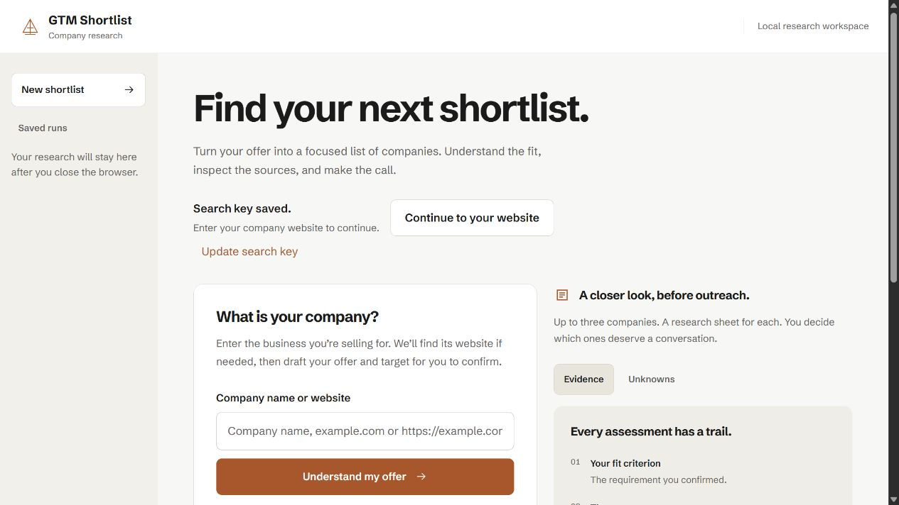

# GTM Shortlist landing demonstration

Planning proposal, 15 October 2026. Branch: `codex/landing-demo-plan`.

## Recommendation

Make the product demonstrate one useful outcome: a company moves from a discovered candidate to an inspected source passage, then to the visitor's own review decision. Keep the existing Eygentic-derived design and GTM Shortlist name. Expand the starting page's explanatory preview into one accessible six-stage player, followed by a full-width example research sheet. The website form continues to start the actual product flow.

**Confirmed entry choice:** the user chose both equally prominent. Put “Play example” and “Research my website” together in the first viewport, with equal button size, weight and orange action treatment. Neither path is a secondary text link. Explain the choice beside the controls: the example is illustrative and uses no research credits; website research uses the actual account, confirmation and credit flow. Neither starts automatically.

This branch contains a plan, a storyboard specification, a validation script, and a baseline screenshot. It changes no application code or brand tokens.

## What exists now

Inspected `web/main.tsx`, `ResearchPreview.tsx`, `ResearchProgress.tsx`, `MarketOverview.tsx` context through its usage, `DESIGN.md`, `PRODUCT.md`, and `docs/agent-experience.md`.

The start page combines a company form with an Evidence/Unknowns guide and a short method section. `ResearchPreview` explains the output but shows no staged investigation. `ResearchProgress` already derives activity from persisted run stages, worker availability and connection state. Active work pauses its motif when hidden; saved checkpoints, actual counts and recovery messages already exist. Keep that behavior.

The production-like local endpoint at port 8014 was unavailable. The baseline was viewed through the repository's isolated fixture server at port 8015, with synthetic providers and a temporary database. No live search, inference, enrichment or outreach was initiated. The screenshot is a fixture view of existing UI, not a proposed redesign or a claim of a healthy production service.

## Preserve the design

- Paper `#f7f7f5`, white sheets, charcoal `#1b1b1b`, muted `#64615b`, orange `#b4501c`, orange hover `#9b4215`, rules `#e1dfd9`, preview `#efede6`.
- Schibsted Grotesk, current heading weights and spacing. Existing 8 px controls, 14 px sheets, 12 px preview corners and 44–52 px touch targets.
- Flat surfaces, thin warm rules and source-reading linework. Orange identifies the selected stage, a deliberate action or an active worker. Status always has text.
- GTM Shortlist remains company-neutral. Eygentic supplies the visual language; no preferred seller, targeting shortcut, new alias, or Eygentic promotional claim enters the public product.

Borrow Explee's accumulating results and stage continuity. Do not import its green palette, Geist font, rounded tab pills, shadows, checkout interruption, or promises of autonomous sending and booked meetings.

## Compare the compositions

| Option | What the visitor does | Trade-off |
|---|---|---|
| A. Six scroll-stacked cards | Scrolls through one explanatory card per stage | Attractive, but repeats the app and hides the complete result behind a long scroll. Sticky stacking is awkward on short phones. |
| **B. One stage player and an inspectable result** | Chooses an equally prominent example or website-research action; the example opens a passage and reviews a company | Shows the actual value in one stable location. Reuses our components and keeps controls readable. Selected composition with the user's dual-entry preference. |
| C. Live website research immediately | Enters a website and waits for the real worker | Relevant to the visitor, but dependent on authentication, configuration, credits and latency. Keep this as the actual product CTA. |

The design-taste exploration offered “quiet instrument”, “dense tiles” and “product performs”. Keep the last concept: let the research sheet demonstrate the claim. Reject the dealt photography, logo-proof row and alternate hero composition because they conflict with the requested existing layout and available evidence. No new visual world is proposed.

## First viewport and page sequence

Preserve the header, page title, website form and existing sidebar in local mode. Do not expose saved runs or local provider settings on an anonymous public landing solely to mimic the app. Public versus authenticated routing needs a separate explicit decision; the present app's `AuthGate` owns access.

On laptop, keep the current input-plus-preview arrangement. Place two equally sized orange actions together beneath the introductory copy: “Play example” and “Research my website”. The right preview opens on a readable example outcome. Play expands the full-width stage player immediately below, rather than compressing a complete sheet into the narrow preview. Research focuses the existing company field, preserving any typed value; the form's submit remains the deliberate start of real research. Keep the form available above the player. Reserve a stable frame height to avoid page jumps, while allowing text enlargement to grow it.

Proposed copy:

- Keep the existing heading, “Find your next shortlist.”
- Supporting sentence: “See which companies fit your offer, inspect the evidence, and decide who to approach.”
- Equal entry actions: “Play example” and “Research my website”. The field's submission action remains “Understand my offer”.
- Persistent example label: “Illustrative sample · no live research”. Live-path helper: “Uses your account and research credits where applicable. Confirm your target before discovery.”
- Example outcome action: “Inspect a passage”. End action: “Research my company”, which focuses the existing company field rather than silently starting a run.

Page argument: the form explains the input; the player shows the transformation; the open source passage proves inspectability; the review action shows human control; the final CTA starts the visitor's own research. Replace the current short method list only after the player demonstrates those same ideas. No fabricated testimonials, pricing or conversion statistics.

## Six-stage storyboard

The demonstration uses invented, explicitly labelled example companies, never invented facts or citations presented as real research. Example passages are labelled “Synthetic example passage”, use reserved `.example` domains, and have no fabricated publication or retrieval dates. A future real captured sample must carry its original source identity and dates.

| Stage | What appears | Interaction and motion | Actual product boundary |
|---|---|---|---|
| 1. Understand offer | The example input becomes an offer summary with editable-looking content clearly inside the sample | A line motif scans once; summary enters 6 px upward | Seller/identity stages; in real research show saved draft only after it exists |
| 2. Explore market | Two sample market observations and a campaign hypothesis | Rows enter with a short stagger; selected hypothesis gets the existing orange edge | Market/campaigns. Search observations are not verified competitors |
| 3. Confirm target | Offer, audience, observable criteria and exclusions | **Pause.** Visitor activates “Confirm example target”; no automatic confirmation | `awaiting_confirmation`; real profile confirmation remains explicit and immutable |
| 4. Discover companies | A few candidate rows resolve to an example shortlist | Replace skeletons with rows; keep the selected campaign in a compact summary | Discovery/selection; real counts come from saved progress and may be fewer than three |
| 5. Inspect evidence | One company opens with a supported finding, an unknown, and an optional sourced-person example | **Pause.** Visitor opens “Inspect example passage”; reveal exact synthetic text directly below its claim | Research findings and saved people; do not imply that a title proves buying responsibility |
| 6. Review and draft | The visitor marks an example decision; an optional draft view cites the example source | Selection changes immediately; draft appears as a separate optional disclosure; stop on the result | Review state, independent human decision, draft-only email and export. No send action |

The focal moment is stage five: a company claim unfolds into its source. Stage six then makes the user's judgment visible. Do not let an email composition animation displace that moment.

## Playback and animation

Start with the finished example still so the page is useful before animation. Play begins only on request. Automatic scene holds total 11 seconds, plus short transitions and an optional 4-second draft reveal. The visitor spends as long as needed at the three interaction pauses. This is presentation timing, never a research ETA. Stage holds: 3 s, 4 s, manual, 4 s, manual, manual. Visitors may skip directly to any stage.

| Action | Proposed value | Rule |
|---|---|---|
| Button/focus/selection feedback | Existing 180 ms | Never wait for an exit animation before acknowledging a click |
| Scene replacement | 280 ms ease-out, opacity and 6 px translate | One moving panel, not the whole page |
| Rows within a newly selected scene | 240 ms, 60 ms stagger, at most three rows | Avoid a long cascade through every record |
| Source disclosure | 220 ms, short vertical reveal | Keep the triggering claim visible and focus stable |
| Sample scan motif | One 900 ms sweep | Runs only within a playing sample; no live-worker implication |
| Completed-stage summary | 300 ms | Keep its content available; do not replay when returning to a stage |
| Real worker activity | Existing online/visible/connected conditions | Never advance a real stage on a demo timer |

No typewriter text, count-up KPIs, decorative particles, spinning logos, auto-scrolling evidence, parallax or infinite page loops. The text arrives complete so visitors can read at their pace. The player ends on the result, with Replay available. Pause on hover, keyboard focus, document hiding, and leaving the viewport; require deliberate resume after an interaction pause. A stage click cancels stale timers.

Reduced motion shows the finished example immediately, disables scanning and movement, and allows instant manual stage changes. Turning motion off must also set every active panel to its visible final state. Never leave a source or CTA at opacity zero. The result remains usable if animation initialization fails.

## Laptop, phone and keyboard behavior

Laptop: stage list at left of a full-width demo sheet, selected content at right, completed summaries available in that list. Keep the two entry actions equally prominent above the input-plus-preview arrangement. Do not shrink screenshots or render tables as tiny images.

Phone: title, the two equal full-width entry actions stacked with the same treatment, form, finished example preview, then the stage selector. Keep both entry actions above the fold at 390×844 without shrinking text or touch targets. Show the current stage title and “Step N of 6”; an “All stages” disclosure gives six normal buttons. Use one content column, natural vertical scrolling, and a persistent-in-component pause/next row. Do not pin the page or steal scroll. Long sources wrap, and optional draft/people details stay collapsed until requested.

Controls: Play, Pause/Resume, Previous, Next, Replay, and All stages. Stage controls are ordinary buttons with `aria-current="step"`, not tabs with incomplete keyboard behavior. Announce deliberate scene changes once through a polite status line. Do not announce every staggered row or synthetic scan. The active pane has a heading; focus remains on the control unless a new dialog is explicitly opened. Disabled controls explain endpoint state through their label or adjacent context. Returning from the demo to the real field preserves any website already typed.

## Implementation map

Use the existing React/CSS stack. No new animation dependency is justified for this scope.

- `ResearchPreview.tsx`: preserve its current explanatory mode. Add an optional landing-demo entry without quietly replacing the output guide used elsewhere.
- New `LandingDemo.tsx`: owns only illustrative stage, playback, pause reason and replay. It never creates a real `Run`, profile confirmation, credit reservation, or API request.
- New `landing-demo.data.ts`: explicitly typed sample with six scenes. Keep illustrative content outside actual API/schema types so it cannot be mistaken for saved research.
- New `LandingDemo.css`: scope styles under a demo class and reuse existing CSS variables; add no palette or typography overrides.
- `main.tsx`: add the player only to the no-active-run start surface. “Research my company” returns focus to the existing field. Do not add an anonymous/auth bypass here.
- `ResearchProgress.tsx`: retain real run ownership. Any later visual improvement derives current/completed/blocked states from `Run` and `progress.events`, independently of the sample player.
- `MarketOverview.tsx`, `WebsiteChoice.tsx`, existing company/evidence and draft views: reuse presentation only where their controls can be made explicitly read-only or sample-scoped. Never pass fabricated records into persistence callbacks.

Sample playback model: `idle`, `playing(stage)`, `paused(stage, reason)`, `awaiting_sample_action(stage, action)`, or `finished`. Pause reasons distinguish user pause, hidden document, focus/hover and offscreen. A pure transition function handles Next, Previous, Select, Play, Pause, ConfirmSample and OpenSamplePassage. Cleanup cancels the active scene timer. Do not create a shared generic state machine for the live worker and sample.

Live system remains: website → saved seller/market/campaign draft → explicit target confirmation → saved candidate/evidence processing → review/draft/export. Disconnection, offline worker, partial delivery, stopped runs and retry preserve output. A failed source produces an unknown or a clear limitation, never a success checkmark.

## Delivery slices and acceptance

1. **Static sample.** Build the six scenes and finished sheet using the existing tokens. Label all illustrative data. Keep the product input functional. Review laptop and phone at actual readable size before motion.
2. **Manual navigation.** Add stage controls, inspectable passage, sample confirmation and independent sample review. Confirm that clicks produce no run, credit, profile or outbound mutations.
3. **Motion.** Add the small transition family, playback cancellation, pause behavior and reduced-motion final state.
4. **Real entry handoff.** Preserve entered website, auth ownership and explicit real target confirmation. Do not add sending, enrichment, checkout or provider calls to the sample.

Acceptance checks for implementation:

- 1366×900, 390×844 and 320 px, plus 200% text sizing: readable controls and sources, no horizontal document overflow, no trapped scroll.
- Keyboard-only: select every stage, pause, inspect passage, record example review, return to the website field; visible focus throughout.
- Reduced motion before load and toggled mid-play: final visible content, no active sweep, no delayed stage jump.
- Background tab, leaving viewport, focus/hover pause, rapid stage changes, Replay, and unmount: no stale timers or surprise scene changes.
- Example mode produces zero research, search, inference, enrichment, auth or billing mutations. No implicit target acceptance.
- Both entry actions have equal visual weight on laptop and phone. Choosing the example preserves typed website input; choosing website research focuses that input and does not submit it or spend credits automatically.
- Actual flow regression keeps saved checkpoints, offline/queued/partial/stop states, independent review, draft persistence and export.
- No false capabilities, fabricated source links or silent research requests. A sample ending with two records must not be padded to three.
- Run TypeScript build, relevant browser checks, Ruff and meaningful backend regression checks. Screenshots at laptop/phone must be opened and inspected, not merely generated.

## Evidence behind the recommendation

The direct investigation of [Explee](https://explee.com/) inspired stage continuity. The investigation's checkout interruptions and suspect sample research are reasons to keep our confirmation and evidence-review boundary explicit. No external site's assets are needed to implement this plan.

Two DEV posts offer useful practitioner examples, not a consensus or formal accessibility standard:

- [Daniel Pertu's four-phase product demo](https://dev.to/daniel_pertu/a-four-phase-state-machine-88-css-rules-and-no-video-in-our-hero-55ca) shows a small React phase owner with CSS motion and a reduced-motion result state. Its comment thread raises SVG scaling sharpness; the author says that comparison was not tested. For our text-heavy research UI, readable DOM is more relevant than animated screenshots.
- [LaWeBe's landing-page motion failure](https://dev.to/lawebe/how-an-accessibility-saas-broke-its-own-landing-and-how-we-fixed-it-5802) reports content becoming invisible with reduced motion and recommends explicit visible fallback states and browser assertions. No comments were returned. Disabling CSS transitions alone does not inherently prevent an observer from revealing content; our acceptance criterion is the actual visible outcome, rather than treating the post's broad causal claim as browser law.

Open decisions: whether anonymous visitors receive a separate public landing route, and final illustrative copy. Entry prominence is settled: both paths receive equal emphasis. Preserve existing routing until its scope is chosen. The proposed motion values are ours, not measured Explee timings or validated user-test results.
