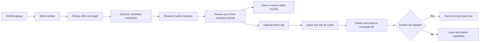

# GTM Shortlist: product and commercial plan

14 October 2026. Product design and validation plan; no customer demand, payment, or product performance has been established.

## The product in one sentence

**Enter your company website, confirm whom you sell to, and receive potential customer companies with reasons and sources you can inspect.**

The first useful result is a person saying, “I would approach this company, and I understand what I still need to find out.” A company appearing in a list does not establish purchase intent, available budget, or an urgent need.

The user selected **GTM Shortlist** as an Eygentic offering alongside GTM Booster, GTM Raptor, and GTM Starship. On 14 October, the user confirmed an **open-source core with an Eygentic managed service**. Describe it as Eygentic's AI system for company discovery and prospect research; the public core is not closed source. Domain availability has not been established. Use the [Eygentic design seed](DESIGN.md) for implementation.

## The first buyer and their problem

The recommended first paying buyer is the owner or lead researcher of a small GTM consultancy, outbound agency, or fractional growth practice serving B2B SaaS. This is a commercial hypothesis to test. Eygentic is the first internal user, rather than the entire market.

| Role | Job in this product | Important distinction |
| --- | --- | --- |
| App buyer | Runs a small consultancy or agency and commissions repeated prospect research | Pays for the workflow or reviewed research pack. |
| App operator | Founder, growth practitioner, or researcher preparing a campaign | Confirms criteria, checks sources, and accepts records. Initially often the buyer. |
| Discovered company | A potential customer of that consultancy or its client | Does not become a buyer of our app merely because we find it. |
| Decision maker at that company | A role or public professional profile relevant to the offer | A role is easier to establish than a verified person or email address. |

Their proposed recurring problem is: “For this offer and segment, I need a fresh list of suitable companies, but finding candidates and checking each website consumes campaign preparation time.” They may already use spreadsheets, search, directories, Clay, or Apollo. We must establish the problem in their actual work before treating it as a market fact.

Qualify an early buyer by behavior: they have an active campaign, prepare lists repeatedly, personally inspect the research, can show their current process, and can authorize a small purchase. A job title or agency website alone does not establish these conditions.

Founder-led B2B SaaS teams are a second market to explore after the first buyer group shows demand. Supporting different offers is a core capability from the start; pursuing multiple buyer groups at once would make initial results harder to interpret.

## The Eygentic example

Eygentic's verified services concern customer acquisition:

| Service | Relevant work |
| --- | --- |
| GTM Booster | Review the ICP, offer, funnel, and channels; prioritize a first acquisition experiment. |
| GTM Raptor | Run a focused acquisition experiment with a segment, hypothesis, prospect list, messages, execution, and evidence report. |
| GTM Starship | Run ongoing controlled experiments, maintain a roadmap, and hand the process to the team. |

These descriptions were checked against Eygentic's website repository and are recorded in the [earlier build plan](../prospect-discovery-build-plan.md). The user's current focus is private AI B2B SaaS startups. The initial app run therefore finds potential customers for these services. It does not assume Eygentic sells software engineering or AI implementation.

Example qualification: a company sells an AI product to businesses; it appears to be an operating private company; its offer is relevant to a confirmed acquisition experiment. Paying customers, employee count, revenue, channel performance, and budget remain unknown unless evidence establishes them. A public growth role or launch can supply context, but does not prove that acquisition is failing.

Later, Eygentic can run the same workflow for a client's own offer using a different seller profile. Keep the Eygentic preset in editable configuration rather than inside qualification logic.

GTM Shortlist produces an inspectable company list. Booster finds the acquisition question worth testing, Raptor runs the focused experiment, and Starship supports ongoing experimentation. Shortlist can be purchased independently or supply research within a Raptor engagement; it does not force customers to buy every service in sequence.

## Why build this when Clay and Explee exist?

We should test a narrower promise: **a repeatable workflow from a seller's offer to an inspectable campaign list**, with an open-source engine and paid operation. We are not proposing a full contact database or all of Clay's workflows.

The inspected [Explee company demo](https://explee.com/auto-gtm/company/consolto.com/explore) moves from company understanding to segments and customers. Its company-first onboarding is a useful pattern. We do not have its commercial company/contact data or evidence that our coverage would match it. See the [observed demo](../../evaluation/explee/explee-jev-laya-evaluation.md).

The [OpenGTM source evaluation](../../evaluation/opengtm-evaluation.md) found reusable ideas in provider selection, caching, and exports, alongside risks in hardcoded targeting, provenance defaults, and inferred facts. Build a smaller core with explicit seller criteria and evidence rules rather than starting by extending its entire system.

Citations, AI summaries, and company search already exist elsewhere. They are useful requirements, not proven differentiation. The product earns a place only if customers accept the research, save preparation time, and buy it again.

## The core workflow



1. **Signup.** Ask for email and seller website, with no payment card. Verify the email. Explain what the sample contains before the user starts. A publicly viewable example can help people understand the format, but must be labelled as a recorded example.
2. **Understand the seller.** Read a bounded set of public pages and draft the offer, buyer types, and two or three possible segments. Show sources. Ask the user to correct the offer, choose one segment, and confirm exclusions. Manual edits must work without another model call.
3. **Discover companies.** Search for company categories, directories, accelerator cohorts, and investor portfolios relevant to the confirmed criteria. Resolve candidates to their own websites. The app must generate candidates; asking for a supplied CSV does not satisfy this job.
4. **Research fit.** Read public company pages. Distinguish supported criteria, contradictory evidence, and unknowns. Separate a proposed acquisition question from a company fact.
5. **Review the sample.** Show up to three fully visible records, source links, timestamps, and unknowns. Let the user mark each “Worth approaching,” “Not suitable,” or “Need more research,” with a reason. Allow export of useful records.
6. **Invite the next step.** Offer a 15-minute setup call after the sample appears. The call confirms the campaign criteria and an available paid pilot. It does not unlock evidence that was hidden in the demo.

The detailed interaction and two alternative sketches are in [Experience sketches](experience-sketches.md).

## What a company record must contain

| Field | Rule |
| --- | --- |
| Company name and website | Resolve the identity; do not attach research to a guessed company with a similar name. |
| Product and customer type | Ground descriptions in fetched pages. |
| Fit by criterion | Supported, contradicted, or unknown, with referenced evidence where available. |
| Relevant public context | A dated launch, hiring page, product change, or other observed context when supported. No invented urgency. |
| Acquisition question | Clearly labelled hypothesis, such as whether the seller could test a new segment. |
| Likely buyer role | Explain why that role owns the relevant work; names and profiles are optional if verified. |
| Sources and freshness | Links, short excerpts, retrieval date, and publication date when established. |
| Missing information | Budget, intent, customer count, or other facts the research could not establish. |
| Research and review state | Complete or partial research; user's acceptance remains separate from model qualification. |

Do not present a numerical “buying probability.” Start with plain explanations and ordered records. A high model score is not evidence of purchase intent. Search snippets identify candidates; fetched pages support record claims. A citation next to a claim is insufficient if the cited passage does not support it.

## Release scope

| Initial release | After payment and repeat-use evidence | Outside this plan's initial release |
| --- | --- | --- |
| Website input, editable seller profile, one target segment | Saved reusable campaign configurations | Automated email sending or scraping private inboxes |
| Actual company discovery and bounded website research | Paid recurring runs and new-company refresh | Full contact database and guaranteed email deliverability |
| Evidence, unknowns, review actions, CSV/JSON export | More providers after coverage comparisons | Clay-style general workflow spreadsheet |
| Saved/resumable runs | Team access when collaboration is observed | CRM integration marketplace |
| Hosted signup, one limited demo, optional booking link | Contact enrichment if customers specifically pay for it | Fully autonomous SDR or promised meetings |
| Minimal operator view for failures, review, and budgets | Campaign-outcome feedback after real campaigns | Bayesian campaign verdicts or TabPFN forecasts |
| Public core, setup guide, reproducible evaluation | Contribution-friendly provider adapters | Tender/procurement discovery for the initial private-company segment |

Website input is the primary entry. Company-name input can use a search to resolve the domain and ask for confirmation; it must not silently choose an ambiguous company. If time is tight, ship a well-explained website field and add name resolution after the first release.

## Open source and paid operation

The public core must be useful without buying our hosted service. It includes seller profiling, editable criteria, discovery, research, evidence validation, review, storage, export, a CLI, and a local UI. Users configure their own search and model providers. The software being free does not make those providers, inference hardware, or hosting free.

Recommended licensing direction: MIT for our original application code, with dependency and model notices. Confirm actual third-party licenses and preserve attribution before publishing. Download model weights through documented provider channels; do not bundle them as if they share the application license.

For the first release, keep the application and hosted adapters in one public repository. Paid value comes from managed credentials, inference, saved accounts, uptime, onboarding, and optional human review. Hosted allowance and billing policies remain separate from research logic. A self-hosted user can run the full workflow with their own budget; the hosted trial limit is not a restriction in the core engine.

Do not build an artificial paid feature split before customers identify a valuable one. Usage fees and operating services are enough to test the model.

## The free demo and search constraints

The user's available SerpApi plan has 250 monthly searches. Official current documentation lists the same free allowance and charges successful searches, including empty successful results; cached and failed searches have different charging behavior. Our limit tracks attempted requests conservatively so uncertain network outcomes cannot create unlimited retries. [SerpApi pricing](https://serpapi.com/pricing), [search API](https://serpapi.com/search-api).

Recommended hosted demo policy:

- One saved demo session per verified account. Reloading resumes it. A deliberate operator reset is recorded; it is not an automatic second free sample.
- At most four total search attempts across name resolution, discovery, follow-up searches, pagination, and retries. No hidden extra search stages.
- At most twelve candidate domains, research at most six, return up to three records. Deduplicate before research.
- Fetch at most three seller pages and three pages per researched company. Cap response size, text, time, and model output in the implementation.
- At most eight model attempts: one seller/segment draft, up to six company extractions, and one shared repair allowance. Hypothesis generation is included in extraction rather than another call for every record.
- Start with one demo job at a time on the worker. Increase concurrency only after measuring inference capacity and global budget behavior.

These are initial engineering limits to tune, not proven yield or performance. If fewer than three usable records are found, show the honest partial result and the reason. Never fill the third position with a weak or invented company merely to complete the layout.

Reserve 50 of the 250 searches for development and evaluation and 200 for live demos as an initial monthly allocation. At four attempts each, that permits at most 50 fully allocated demos before cache reuse or provider changes. This is capacity arithmetic, not a forecast of signups or qualified companies.

[Tavily currently offers 1,000 free monthly credits](https://docs.tavily.com/documentation/api-credits). Basic search uses one credit and advanced search two. It is a candidate to benchmark, not an established coverage improvement. Disable automatic advanced selection in the bounded demo. Choose the default provider from the real coverage/cost evaluation; retain SerpApi as a supported option rather than making it mandatory.

Website retrieval is separate from search. Do not spend a search request merely to fetch a known public URL. Keep source attribution, accessible-page limits, and provider conditions in the adapters.

## Pricing experiments

| Offer | Proposed price | Included | Evidence sought |
| --- | --- | --- | --- |
| Open-source software | Free software | Full self-hosted core with own providers | Useful independent adoption and contributions. |
| Hosted sample | Free once | Up to three real researched company records | The user finds the work relevant enough to inspect, accept, and use. |
| Reviewed pilot | USD 99 once | One agreed segment, twenty researched company records, human review, evidence report, CSV, and one correction pass | Willingness to pay for a usable research result. |
| Hosted subscription, later | USD 49/month | Four self-service runs, up to twenty-five researched company records per run, saved profile, export; no included human review | Repeated paid software use and sustainable cost. |

All prices and limits are hypotheses. A paid human-reviewed pack validates a service result, not a subscription. Do not enable subscription purchases until the app can reliably deliver the advertised allowance.

Pilot scope is agreed before payment. Check public coverage first. If twenty records cannot be researched responsibly, offer a smaller priced scope or decline that campaign. Correct duplicates and explicit ICP mistakes. Do not guarantee that a researched company will accept outreach or buy.

For larger runs, do not reuse the demo's eight-model-call cap. Provision a separate paid policy and measure how many candidates must be researched to deliver the requested output. “Twenty-five researched records” is not “twenty-five qualified leads.” Duplicate records and provider failures do not consume a completed-record allowance. Disclose how records with contradictory evidence count before selling the offer.

## Setup call and paid delivery

Use an existing scheduling link rather than developing scheduling software. The product records a booking-link click separately from an actually booked or attended call.

The 15-minute call has a concrete purpose:

1. Ask which sample companies the buyer would approach and why they rejected others.
2. Confirm the offer, one segment, locations, mandatory criteria, exclusions, and current campaign timing.
3. Agree on the pilot record count, correction scope, price, and delivery date.
4. Send an invoice or payment link through the operator's normal process when the customer accepts the offer. Start paid delivery after confirmed payment.

The initial operator reviews research through an internal queue that uses the same evidence records as the customer UI. Manual review must be disclosed where it affects the sample or turnaround. A paid pilot should end with a short review of usefulness, actual time saved, and whether another campaign needs research.

Subscription onboarding follows only when repeat demand exists: payment confirmation grants an allowance; customers can see remaining runs, renewals, cancellation, saved data, and export. A browser redirect alone must never be treated as proof of payment.

## How to find the first customers

Build a manually reviewed list of thirty potential app buyers, starting with small B2B SaaS GTM consultancies and outbound agencies. Use existing relationships, public agency websites, professional networks, and relevant directories. Prioritize ten with a visible offer and a plausible active campaign. A visible offer is a research input; confirm campaign activity in conversation.

Prepare a small sample for each buyer's own offer, rather than showing only Eygentic's prospects. Limit this initial work to the same measured budgets. Personalizing a sample can be manual during validation, but the product must still do actual candidate discovery and research.

Proposed outreach pace: five individual messages per workday, one follow-up after four business days, then stop if there is no response. The product does not send these messages automatically. This plan authorizes no messages to external people.

Draft first message, use only after doing the referenced work:

> Hi [name], I saw that [agency] helps [specific buyer] with [offer]. I'm building an open-source tool that turns an offer into company research with source links. I researched three companies against that offer. Would it be useful to send you the sample and hear which ones you'd actually approach?

Draft follow-up:

> Following up on the company sample for [specific offer]. If prospect research is part of an active campaign, I can share the evidence and unknowns for each record. If this isn't useful right now, I'll leave it here.

After permission to share, send the sample or signup link with an accurate description. Ask about their existing process before pitching. Do not claim time saved, customer results, or an existing relationship that has not been established.

A useful landing page needs the promise, who it is for, a clearly labelled example with sources, the three-company sample CTA, a brief explanation of the open-source version, and a transparent next step. “Start my company sample” is more concrete than “Get AI leads.” Early pricing can describe the reviewed pilot; recurring pricing remains “being tested” until available.

## Economics and side-hustle constraints

Record search attempts and charges, fetched pages, inference usage, review time, support time, payment costs, refunds, and collected revenue for each customer. Include unsuccessful discovery, not just the final three records.

```text
contribution before fixed costs
  = collected revenue
  - refunds
  - payment charges
  - variable provider charges
  - delivery and support time × chosen hourly value
```

As a planning assumption, value founder time at USD 25/hour. A USD 99 pilot with two hours of work and USD 10 of other variable costs contributes USD 39 before fixed costs. At four hours it loses money before fixed costs. Change the workflow, scope, or price if measured delivery resembles the second case.

Twenty subscriptions at USD 49 equal USD 980 gross monthly revenue, not profit or a forecast. Hosted databases, workers, email delivery, inference, and monitoring still cost money. [Supabase's current pricing](https://supabase.com/pricing) includes a paid tier from USD 25/month; Render and model-serving costs require an actual configuration quote. Do not assume a free web tier is durable production infrastructure.

Keep the first month's work within a proposed five-to-eight-hour weekly operating budget after launch. Start with no more than three concurrent paid pilots, agreed delivery dates, and a waitlist when capacity is reached. Measure the real hours before increasing customer volume.

## Validation and decision gates

These are proposed decision thresholds for a small initial test, not industry benchmarks.

| Gate | Evidence to collect | Continue when | If it fails |
| --- | --- | --- | --- |
| Discovery works | Five repeatable runs across three seller profiles; source audit | Finds actual new company candidates; no wrong identities or unsupported critical claims in audited output | Fix discovery and evidence before polishing acquisition. |
| Sample is useful | Five external target buyers, fifteen sample records | At least three buyers accept at least one record; understand why other records fail | Change criteria, sources, or first buyer segment. |
| Workflow helps | Observed buyer sessions and comparison with their current process | Buyers can complete the flow without explanation and use/export research; measure review time | Fix the bottleneck actually observed. |
| Pilot sells | Ten relevant buyers see usable samples | Aim for three paid pilots within the first thirty days; do not infer willingness from praise | Revisit the problem, offer, price, or distribution before adding integrations. |
| Repetition exists | Campaign follow-up and paid requests | At least one repeat purchase or repeated paid self-service use | Keep it as a pack/service or investigate a different recurring job. |
| Software sustains itself | Subscription usage and measured costs across two cycles | Positive contribution after valued support time, with enough margin to cover fixed costs | Reduce costs/scope, adjust price, or stop the subscription experiment. |

Payment is stronger evidence than a booked call; actual use is stronger than a generic positive review. Report observed counts and reasons, not percentages that hide a tiny sample.

Track signup started/verified, target confirmed, demo ready/partial, accepted records, export used, booking-link clicked, call booked, call attended, pilot paid/delivered, repeat order, and cancellation reason. Use deduplicated server events for state changes. A clicked booking link is not a booked meeting. Keep analytics about workflow events rather than storing customer page contents in analytics.

## Risks that shape the first release

- **Wrong-company research:** require domain confirmation, canonical identity, and redirect checks. Keep ambiguous identities out of qualified output.
- **Search is useful but too sparse:** benchmark providers on the same criteria; return partial results honestly; reduce scope before charging for a pack.
- **Plausible summaries contain invented pain:** use criterion-level evidence and unknowns; audit critical claims; test negation and stale sources.
- **Inference cannot meet the experience:** benchmark a real Gemma checkpoint on available hardware before selecting a host. Queue honestly or cap access; do not promise instant results without measurements.
- **Nobody needs a second list:** test campaign frequency before subscriptions and scheduled refresh.
- **Human review eats the margin:** measure time per record; paid automation is only justified if quality survives lower review effort.
- **Free demos exhaust credits:** enforce account and provider budgets on the server, reserve before spending, and expose an honest availability state.

## Community evidence and its limits

@heynikhila's first-person article, [“I Replaced Our $647/Month SaaS Stack With Open Source. We Saved $8.”](https://dev.to/heynikhila/i-replaced-our-647month-saas-stack-with-open-source-we-saved-8-4lpc), describes maintenance work that can outweigh licence savings. It supports testing paid operation and support as the offer; it does not establish demand for this product.

@zero-ai-developer's account in [“I Tried to Build a Company Where AI Autonomously Finds, Wins, and Delivers Work. Here's Why It Failed.”](https://dev.to/zero-ai-developer/i-tried-to-build-a-company-where-ai-autonomously-finds-wins-and-delivers-work-heres-why-it-5f3c) describes a technically working pipeline without paying work. That account reinforces the need to test usefulness, purchase, and trust separately. Both articles had no comments returned during this review; these are author reports rather than community consensus.

Which part of our first customers' current process actually consumes the most time: finding candidate companies, verifying fit, or deciding whom to approach? Record that answer during observed sessions and let it determine the next feature.

## Source and planning status

Verified product observations, repository findings, official provider documentation, user choices, and proposed commercial experiments are intentionally distinguished above. The challenge rules and release date are in the [delivery plan](delivery-plan.md); the system contracts and operating checks are in the [architecture](architecture.md). This plan does not prove industry-wide demand or certify a provider's data quality.
